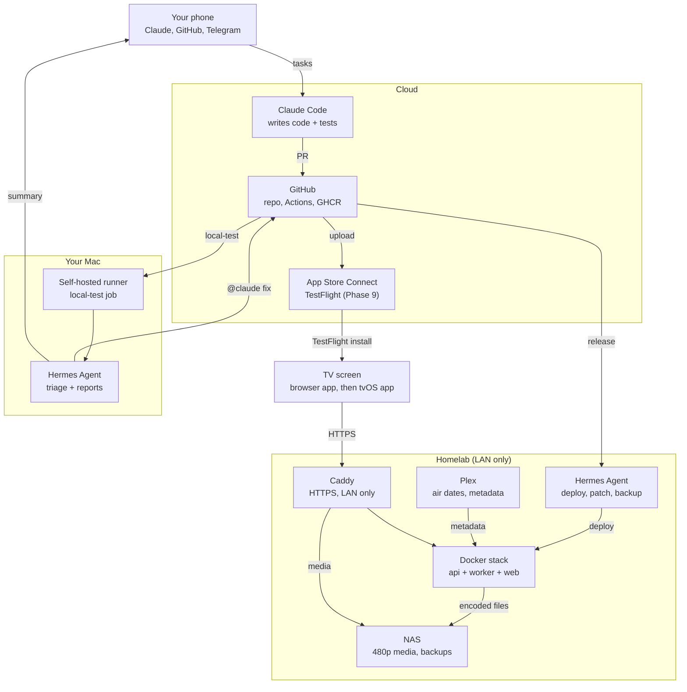

# Retro Cable for Apple TV — Build Plan

Approved Nov 1, 2026 · Brandon Tabaska

Bay Area cable as it was on today's date in any year from 1990 to 2010: a browser app first, then an Apple TV app, built entirely by agents and run on the homelab.

## Decisions locked

| Area | Decision |
| --- | --- |
| Frontend | Browser app first (same TV interface), then a native tvOS app (SwiftUI + AVKit) |
| Backend | Custom scheduling engine; open-source pieces reused only where they win |
| Year range | 1990–2010, set in the UI |
| Clock | Same calendar date and time of day in the chosen year; that date's weekday in that year sets the programming (Oct 31, 1998 was a Saturday, Oct 31, 1997 a Friday) |
| Episode eligibility | Anything that had aired by the simulated date: new episodes plus reruns |
| Between shows | Back-to-back programs with one short bumper or promo between, no commercials |
| Holidays | Holiday episodes and specials favored near the holiday; holiday calendar is editable |
| Movies | Yes: Disney Channel Original Movies, holiday specials, movie channels |
| Guide | One 2000s digital-cable grid style for every year |
| Channel existence | Hidden before launch (Cartoon Network 1992, Toonami 1997, Adult Swim 2001); Boomerang always shown |
| Toonami, Adult Swim | Their own 24/7 channels |
| Region | Mountain View, CA (San Francisco Bay Area stations) |
| Build agents | Claude Code in the cloud writes all code; Hermes on the Mac runs local build and test; Hermes on the homelab deploys and patches |
| Apple signing | Paid Apple Developer account ($99/yr) and TestFlight, starting with the tvOS phase |
| Archive list | Claude proposes a full lineup per channel; Brandon prunes |

## How the work flows

Claude chat planned it, Claude Code builds it, Hermes tests and maintains it, and you approve from your phone.

1. You message Claude Code from your phone with a phase task (prompts are in `docs/phase-prompts.md`).
2. Claude Code reads `CLAUDE.md` and the specs, writes tests and code, and opens a PR.
3. GitHub Actions runs fast checks in the cloud; the self-hosted runner on your Mac runs the full local test and Hermes reports back.
4. A Claude review pass comments; you merge from your phone.
5. Merge to `main` publishes a container image (and from Phase 9, a TestFlight build).
6. Hermes on the homelab deploys with an allowlisted script, runs smoke tests and messages you.
7. You refresh the browser app; from Phase 9, TestFlight updates the Apple TV app too.

## Architecture

## Scheduling engine

The schedule is a pure function of (channel, simulated date, catalog version, seed), so nothing streams until you tune in and changing the year is instant.

### Simulated clock

- Simulated time = chosen year + today's month and day + the current local wall-clock time. Feb 29 falls back to Feb 28 in non-leap years.
- The simulated date's own weekday picks the day-part template (Oct 31, 1997 runs a Friday schedule).

### Channels and carriage

- Each channel has year-ranged identity: number, call sign, logo and bumper set. Example: NBC is KRON 4 through 2001 and KNTV 11 from 2002.
- Each channel has a launch date and is hidden before it (Boomerang excepted).
- Each show has carriage windows per channel, so Futurama can be on Fox 1999–2003 and on Adult Swim from 2003.

### Day-part templates

- Each channel has YAML templates of day-parts per weekday type: weekday mornings, after school, primetime, late night, Saturday morning, Sunday.
- Templates have era versions (Cartoon Network 1992–96 leans on classics; 1997+ adds originals). Claude drafts them; you edit the YAML.
- A day-part names a weighted pool (specific shows or tags like `nick-live-action`), not fixed episodes.

### Episode eligibility and order

- An episode is eligible when its first US air date is on or before the simulated date. Anime and imports use their US debut, set by per-show overrides (Dragon Ball Z counts from its US run, not its 1989 Japanese premiere).
- Each (channel, show) walks its eligible episodes in original air order. The position is computed, not stored: items elapsed since an anchor date, plus a seeded offset, modulo the eligible count.
- If a show premiered an episode that same week on that weekday, its primetime slot airs that one and the guide marks it NEW. Everything else is a rerun.
- An episode missing from the NAS is skipped; a show with no files leaves the pool and is listed in the gap report.

### Holidays, specials and movies

- Episodes carry holiday tags. Tags come from metadata keywords plus a classification pass at ingest, with a manual override file.
- Inside a holiday window (e.g. Oct 24–31), a show's tagged episodes are preferred, and specials are injected into prime day-parts.
- Movies and specials run their full length back to back and respect their premiere date (Halloweentown can't air before Oct 1998).

### Back-to-back programming

- Programs run back to back with no ads, so start times are real: 8:00, 8:22, 8:45.
- One short bumper or promo for a later show plays between programs; none if the channel's pool is empty.
- Day-parts anchor the day: when primetime begins at 8:00, the program already running finishes first, so primetime may start at 8:04.
- The guide draws each program at its true length, so a 22-minute episode is a narrower cell than a 44-minute one.

### Tuning in

- `GET /tune/{channel}` returns the current item, the offset in seconds and the next few items. The app starts the file at that offset; no server process runs per channel.
- Day schedules are cached and regenerated when the catalog or templates change.

## Custom channels and the AI station manager

All of these change the scheduler's inputs (channels, carriage, dates, holidays, weights), never the schedule itself, so one set of tests guards your edits and the AI's alike.

### Your own channels

- A channel is a YAML file or an admin form: name, number, logo, bumper set, launch year (or "always on") and its templates.
- Three channel types: **network** (day-part templates), **marathon** (one or a few shows in order), **movie** (a hand-curated playlist in your order or shuffled).
- A "Netflix" channel is a network or marathon channel built from your own copies of those shows, with synthetic dates.

### Synthetic air dates

- Any show can get a synthetic premiere date inside 1990–2010. The spacing between its real episode dates is kept, so a season still unrolls week by week.
- Or mark a show "library": every episode available whenever its channel is on, like Boomerang.
- Transplants slot into real blocks: Gravity Falls (2012) with Disney Channel carriage from a synthetic 2004 premiere airs beside Kim Possible.
- The guide can show a small mark on transplanted shows or hide it, per channel.

### Shows still running today

- Only episodes aired by the simulated date are eligible, and the latest simulated date is Dec 31, 2010. SpongeBob, Sesame Street, Arthur and The Simpsons only need seasons through 2010 archived.
- Pokémon isn't in the lineup yet: it aired on Kids' WB before moving to Cartoon Network in the mid-2000s. Add it as Cartoon Network carriage, a transplant, or a Kids' WB block.

### Holidays you control

- Holidays live in `catalog/holidays.yaml`: name, date rule (fixed like Mar 17, or rules like the fourth Thursday of November), window length, strength and tags.
- St. Patrick's Day is included with The Luck of the Irish (Disney Channel, 2001) tagged; the tagger proposes more candidates for you to confirm.
- Per channel, each holiday is on, off or specials only.

### Admin panel

- A phone-friendly web admin at `/admin` on the LAN: channels, shows on or off per channel, carriage windows, synthetic dates, holidays, movie playlists, AI proposals, device pairing.
- Every change previews a week of the guide and runs the scheduler checks before it saves.
- Changes are versioned with one-tap undo, and a nightly job commits them to the repo as YAML.

### AI channel builder (local model)

- Give it a channel name, the shows you want and a vibe ("Saturday morning, 1996"). Your local model drafts templates, carriage, synthetic dates, holiday tags and bumper style.
- The draft is YAML validated against a schema; you approve it after a week's preview, in the admin or in Telegram.
- It runs on the 3090 Ti through LiteLLM, so nothing at runtime depends on Claude.

### AI station manager (weekly, local model)

- Signals: watch time and completion per show, early tune-aways (under 3 minutes), channel dwell, an hour-of-week heatmap of when you watch, and likes (hold Select on the info banner).
- Each Sunday it proposes a diff: more weight for shows you finish, less for ones you skip, rebalanced day-parts.
- **Power hour**: your busiest viewing hours (say 8–9 p.m.) become a day-part where every channel pulls from your top shows on that channel.
- An authenticity dial per channel (0 = era-accurate, 100 = all favorites) caps the drift; proposed default 30.
- Guardrails: at most about a fifth of slots change per week, date eligibility never bends, the same property tests must pass, every change is logged with one-tap rollback.
- Hermes runs it and sends you the proposal; auto-apply is a toggle.

## Media pipeline and storage

Plan on 4–6 TB for the full proposed lineup at 480p, or 2–3 TB once you prune it by half.

### Pipeline

1. **Archive** your copies to the NAS in Plex naming (`Show (Year)/Season 01/Show - S01E01.ext`). Bumpers and promos go in `_bumpers/<channel>/<era>/`.
2. **Match** in Plex as you do today. Plex's TVDB/TMDB matching supplies each episode's original air date.
3. **Import**: a catalog job reads the Plex API (show and episode GUIDs, air dates, runtimes, file paths) into the app's SQLite catalog. TMDB fills gaps; a YAML file holds US-debut and carriage overrides.
4. **Normalize**: an ffmpeg job writes H.264 + AAC stereo MP4s at 480p (4:3 kept as 4:3) with the index at the front, so playback can start mid-file. It uses NVENC on the 3090 Ti box when free, the NAS CPU otherwise.
5. **Tag**: a classification pass marks holiday episodes from titles and summaries; low-confidence tags go to a review list.
6. **Report**: an inventory by channel and year (episodes on disk vs. expected, missing shows, untagged specials). These are your measurements.

The app plays the normalized files straight from Caddy, so Plex is a metadata source, not in the playback path.

### Storage math

At about 1.2 Mbps video plus 128 kbps audio, files run about 10 MB per minute (approximate).

| Item | Count (approx., full list) | Size each | Total |
| --- | --- | --- | --- |
| Half-hour episodes (~22 min) | 15,000 | 220 MB | 3.3 TB |
| Hour episodes (~44 min) | 2,500 | 440 MB | 1.1 TB |
| Movies and specials | 150 | 0.9 GB | 0.14 TB |
| Bumpers and promos | 2,000 | 5 MB | 0.01 TB |
| **Total** | | | **~4.6 TB** |

The inventory job replaces these estimates with real counts after the first import.

## Frontend: browser first, then tvOS

The first frontend is a browser app with the same TV interface, so agents can test every change in a headless browser and you can try it on any screen within minutes. The tvOS app follows once the browser app is right; both use the same API and design tokens. Mockups are in `docs/mockups/` (open the .html files or view the .png screenshots).

### Browser app (Phases 1–8)

- TypeScript, React and Vite, built to static files that Caddy serves at `tv.home.tabaska.us`; the admin panel lives in the same app under `/admin` with a phone layout.
- A 1920×1080 "10-foot" layout scaled to the window, so a laptop, a TV browser or your phone all show the cable-box screens.
- Arrow keys, Enter and Esc mirror the Siri Remote through a spatial-navigation layer, so focus moves cell to cell as it will on tvOS.
- Playback is a native `<video>` element on the normalized MP4s, starting at the offset `/tune` returns.
- The API client is generated from the OpenAPI spec, the same contract the tvOS app will use.
- Design tokens (colors, type sizes, spacing) live in `design/tokens.json`: CSS variables now, Swift constants later.

### tvOS app (Phase 9)

| Screen | What it does | Remote |
| --- | --- | --- |
| Live TV (launch screen) | Full-screen video, 4:3 pillarboxed; info banner for 4 s on every tune | Swipe or click up/down = channel up/down; Play/Pause = last channel; hold Select = like |
| Info banner | Channel number, call sign, title, episode, progress bar, next program | Click center to open the guide |
| Guide | 2000s grid: about 7 channels × 90 minutes visible, cells sized to real run times, scrolls 12 h ahead, details panel and live picture-in-picture | Select = tune; Play/Pause = year picker |
| Year picker | 1990–2010 grid, shows the simulated date and which channels are on the dial | Select = set year and retune |
| No signal | Era-style card when the server is unreachable, retrying in the background | — |

- SwiftUI + AVKit, ported screen by screen from the browser app, which serves as the working reference.
- The guide grid is a custom focusable layout, not a `List`, so focus moves like a cable box.
- Target channel-change time under 1.5 s on both frontends.

## Hosting, networking and security

Everything runs as one Docker Compose stack on an always-on homelab host, reachable only on your LAN at `tv.home.tabaska.us` through your existing Caddy.

| Service | Role | Exposure |
| --- | --- | --- |
| `api` | FastAPI: schedule, guide, tune, profile, telemetry intake, OpenAPI spec | Caddy → LAN only |
| `worker` | Plex import, ffmpeg normalize, holiday tagging, inventory report | None |
| `web` | Static browser app: TV screens plus `/admin` | LAN only; admin behind a password |
| `media` | Caddy `file_server` over the normalized media, read-only mount, byte ranges | LAN only, signed URLs |
| Observability | Prometheus, Loki, Grafana | LAN only |

SQLite holds the catalog and profiles; it is backed up nightly to the NAS.

### Network

- Split DNS: `tv.home.tabaska.us` resolves to the host's LAN IP inside the house and nothing outside.
- Caddy gets a real certificate via the DNS-01 challenge, so tvOS gets HTTPS without App Transport Security exceptions.
- The site block rejects any client outside private IP ranges; no port forward is ever added.
- Viewing away from home is out of scope for v1; Tailscale is the add-on path later.

### Access control

- Device pairing: the app shows a 6-digit code, you approve it in the admin (or Hermes asks you in chat), and the server issues a device token.
- Media URLs are HMAC-signed and expire in a few hours.
- App Store Connect keys live only in GitHub secrets. Homelab secrets live in a `.env` readable only by the deploy user.

### Hermes guardrails (homelab)

- Runs as its own Unix user with no shell sudo, only allowlisted scripts (`deploy.sh`, `rollback.sh`, `patch.sh`, `ingest.sh`, `backup.sh`).
- Its chat gateway answers only your account. Destructive actions (rollback, deleting media, reboots) need your reply first.
- It talks to your local model stack through LiteLLM.

## Git, CI/CD and releases

One private monorepo, `btabaska/retro-cable`; every merge to `main` produces a server image (and from Phase 9 a TestFlight build) without you touching a computer.

| Path | Contents |
| --- | --- |
| `CLAUDE.md` | Rules for agents |
| `docs/` | This plan, specs, phase prompts, status |
| `server/` | Python 3.12, FastAPI, SQLite, scheduler package, worker jobs |
| `web/` | TypeScript browser app and `/admin` |
| `tvos/` | SwiftUI app from Phase 9, generated by XcodeGen |
| `catalog/` | YAML: channels, eras, carriage, templates, overrides, holidays |
| `design/tokens.json` | Shared design tokens |
| `ops/` | Compose files, Caddy snippet, allowlisted scripts, Hermes skills |

### Workflow

- Trunk-based: short branches, one PR per task, conventional commits.
- Branch protection on `main`: CI green plus your approval. A Claude review pass comments first.
- Release Please turns merged commits into tags and a changelog.

### Pipelines (GitHub Actions)

1. **Server, every PR**: ruff, mypy, pytest with property tests, OpenAPI diff check against the generated web client.
2. **Web, every PR**: typecheck, Vitest, Playwright end-to-end in headless Chromium on fixture media.
3. **local-test, labeled PRs**: on your Mac's self-hosted runner (see below).
4. **On merge**: multi-arch server image to GHCR, tagged with the version.
5. **From Phase 9, on merge**: fastlane signs and uploads to TestFlight; a monthly rebuild keeps builds from expiring after 90 days. These run on the Mac runner to keep cloud macOS minutes near zero.

## Local build and test on your Mac

GitHub is the handoff point: Claude Code opens PRs, a self-hosted runner on your Mac tests them against a real local stack, and Hermes on the Mac reads the results and hands failures back to Claude Code.

| Piece | Runs on | Job |
| --- | --- | --- |
| Claude Code | Cloud | Writes code and tests, opens PRs, fixes failures |
| GitHub Actions | Cloud | Fast checks on every PR |
| Self-hosted runner | Your Mac | `local-test`: full stack in Docker, Playwright in WebKit and Chrome; tvOS builds from Phase 9 |
| Hermes Agent | Your Mac | Watches results, retries flaky tests, repairs its environment, writes failure reports, sends summaries |
| Hermes Agent | Homelab | Deploys, patching, ingest, backups |
| You | Phone | Read summaries, merge, ask for a TV check |

### The loop

1. Claude Code opens a PR labeled `local-test`; cloud CI runs fast checks.
2. The Mac runner checks out the PR, starts `ops/compose.test.yml`, runs Playwright, saves traces, screenshots and video, and posts pass or fail.
3. Hermes on the Mac acts on the result:
   - **Pass**: Telegram summary with screenshots and the PR link.
   - **Flaky**: retries once and files an issue to fix the test.
   - **Environment** (Docker stopped, disk full): fixes it from its runbook and reruns.
   - **Real bug**: posts a structured report on the PR and mentions `@claude`, which triggers the Claude Code GitHub Action to push a fix. After three rounds without a pass, it asks you.
4. You merge; the homelab Hermes deploys.

### Fixture media

- `make fixtures` generates fake shows with the show, episode and a running timecode burned into the picture, plus fake bumpers.
- Tests check the player's position against the offset `/tune` returned; screenshots show the timecode at a glance.
- No real video in the repo or CI; an opt-in suite on the Mac plays a few real NAS files read-only.

### Guardrails (Mac)

- The runner serves only this private repo, under its own macOS user. Never attach it to a public repo.
- Hermes on the Mac runs only allowlisted commands (`gh`, `docker compose`, `make test-*`, `npx playwright`, `xcodebuild`, runbook scripts). It can't merge, push to `main` or read release secrets.
- If the Mac sleeps, `local-test` jobs wait in GitHub's queue; cloud checks still gate every PR.

## Testing

| Layer | Tests | Runs |
| --- | --- | --- |
| Scheduler invariants | Hypothesis property tests: no episode before its debut; no hidden channel; no gaps or overlaps; deterministic; midnight and DST safe; holiday windows pull only tagged items | Every PR |
| Scheduler golden days | Snapshots for Oct 31 1998, Dec 24 2003, Sep 2 2001 (Adult Swim launch), Jan 1 2002 (NBC switch) | Every PR |
| API | Contract tests against OpenAPI; signed-URL expiry; pairing | Every PR |
| Ingest | Plex API from recorded responses; ffmpeg on a sample clip; tagging with a stubbed model | Every PR |
| Web | Vitest units; Playwright flow: launch → banner → guide → tune → change year | Every PR (Chromium), Mac (WebKit + Chrome) |
| tvOS (Phase 9) | Unit tests and XCUITest for the same flow | Mac, tvOS Simulator |
| Post-deploy smoke | `/health`, tune three channels, fetch one media range, check Grafana | Every deploy |
| On the couch | Your phase checklist: channel change feels instant, guide matches what plays | Phase sign-off |

## Telemetry

The server exports OpenTelemetry to Prometheus, Loki and Grafana; the app reports playback events to the server.

| Signal | Source | Used for |
| --- | --- | --- |
| Tune latency (tap → first frame) | App event | Alert if p95 exceeds 2 s |
| Stalls and playback errors, with file and offset | App event | Finds bad encodes for re-encoding |
| Schedule generation time, cache hits | API metrics | Catches slow catalogs |
| Missing-file skips per channel | Scheduler log | Gap report and archive to-do list |
| Request logs and errors | API logs → Loki | Debugging by agents |
| Disk, CPU, transcode queue | Node exporter, worker | Capacity and ingest progress |
| Watch history, likes, hour-of-week | App event | Station manager and pruning |

## Maintenance with Hermes (homelab)

| Job | When | What it does | Asks you first? |
| --- | --- | --- | --- |
| Deploy | New GitHub release | Pull image, migrate DB, restart, smoke test, auto-rollback on failure | No (reports result) |
| Rollback | Smoke test fails or you ask | Restore previous image and DB snapshot | Yes, unless automatic |
| Ingest | Nightly 2 a.m. and on new Plex items | Import, normalize, tag, update inventory | No |
| Container patching | Weekly | Update base images; Renovate PRs cover app dependencies | No |
| OS patching | Weekly | Security updates; holds reboots for approval | Yes, for reboots |
| Backups | Nightly | SQLite and config to the NAS; monthly test restore | No |
| Cert and DNS check | Daily | Certificate validity and split DNS | No |
| Weekly report | Sunday | Telemetry summary, archive gaps, pending approvals, AI proposal | — |

When a job fails in a way its runbook doesn't cover, Hermes opens a GitHub issue with logs; Claude Code fixes the cause in the repo.

## Costs

| Item | Cost | Notes |
| --- | --- | --- |
| Apple Developer Program | $99/yr | Only from Phase 9 (tvOS) |
| Claude Code (cloud) | Your existing Claude plan | Heaviest during Phases 1–6 |
| GitHub Actions | Near $0 | Mac-only jobs run on your self-hosted runner |
| Disk | Only if the NAS lacks ~5 TB free | Prune the archive list first |
| Hermes, local models, Plex, Caddy, Grafana | $0 | Open source or already owned |
| TMDB API | $0 for personal use (confirm terms) | Metadata gaps only |

## Build plan, step by step

Thirteen phases; each ends with something you can see or a report, and agents move on only after you sign off. Ready-to-paste prompts are in `docs/phase-prompts.md`.

0. **Permits (you, about an hour, once)**: repo created ✓; connect it to Claude Code on the web and install the Claude Code GitHub app; install Hermes on the Mac and the homelab host, both on LiteLLM and Telegram or Signal; register the Mac as a self-hosted runner (labels `self-hosted, macOS, retro-cable`); add the split-DNS record and a Caddyfile `import` for `ops/caddy/retro-cable.caddy`.
1. **Skeleton**: repo layout, `CLAUDE.md`, server and web CI, fixture generator, empty API, "hello" browser app. *Done when* Hermes deploys it and the Mac runner posts its first local test report.
2. **Catalog and measurements**: Plex import, YAML catalog with validation, inventory report. *Done when* the report lists episodes per channel and year, plus gaps.
3. **Scheduler**: engine, property tests, golden days, `/guide`. *Done when* `/guide?year=1998&date=10-31` returns a full, gap-free, back-to-back day for every channel.
4. **Media and tuning**: normalize job, signed media URLs, `/tune`. *Done when* the browser plays a tuned channel from the right second.
5. **Live TV in the browser**: playback at offset, channel up/down, last channel, info banner. *Done when* flipping channels feels like cable.
6. **Guide and year picker**: from the mockups, cells at true run times. *Done when* the guide matches what plays and changing the year retunes instantly.
7. **Feel**: bumpers and promos, holiday windows, movies and specials, NEW badges. *Done when* Oct 31, 1998 plays Halloween episodes and Halloweentown.
8. **Operations**: telemetry, dashboards, every Hermes job, backup restore test. *Done when* you get the first Sunday report.
9. **tvOS app**: enroll in the Apple Developer Program, App Store Connect record and API key, TestFlight on the Apple TV, then port the screens. *Done when* the Apple TV app matches the browser app.
10. **Admin panel and custom channels**: `/admin` with channel types, synthetic dates, transplants, holidays, show on/off, week preview, undo. *Done when* you build a Disney movie channel and a St. Patrick's Day window from your phone.
11. **Local AI**: channel builder and weekly station manager, likes, power hour, authenticity dial, approvals via Hermes. *Done when* an applied proposal changes your 8 p.m. lineup.
12. **Polish**: device pairing, no-signal screen, Top Shelf, performance pass.

## Assumptions to confirm

Agents can start Phases 1–2 on these defaults; tick or correct each.

- [ ] Which always-on homelab host runs the stack (the NAS if it runs Docker, otherwise a small server; not the gaming PC). **Needed before the first deploy.**
- [ ] Bay Area locals: KTVU 2 (Fox), KPIX 5 (CBS), KRON 4 → KNTV 11 (NBC, 2002), KQED 9 (PBS). Add KTEH 54 San Jose PBS too?
- [ ] ABC (KGO 7) stays out.
- [ ] Cable channel numbers are invented unless you remember your provider's lineup.
- [ ] Nickelodeon becomes Nick at Nite reruns in the evening, or stays kids shows 24/7?
- [ ] Fox Kids is a block on Fox (Saturday mornings, weekday afternoons) through 2001.
- [ ] Authenticity dial defaults to 30; AI proposals need approval until you turn on auto-apply.
- [ ] Transplanted shows get a small mark in the guide (or none?).
- [ ] Viewing is LAN only for v1.
- [ ] Hermes runs twice: on the Mac for build and test, on the homelab for operations.
- [ ] Phases 1–8 are signed off in the browser app, on any screen you like.
- [ ] Your Apple TV model and tvOS version (for Phase 9).

## Archive list

The per-channel show list to prune is in `docs/archive-list.md`.
