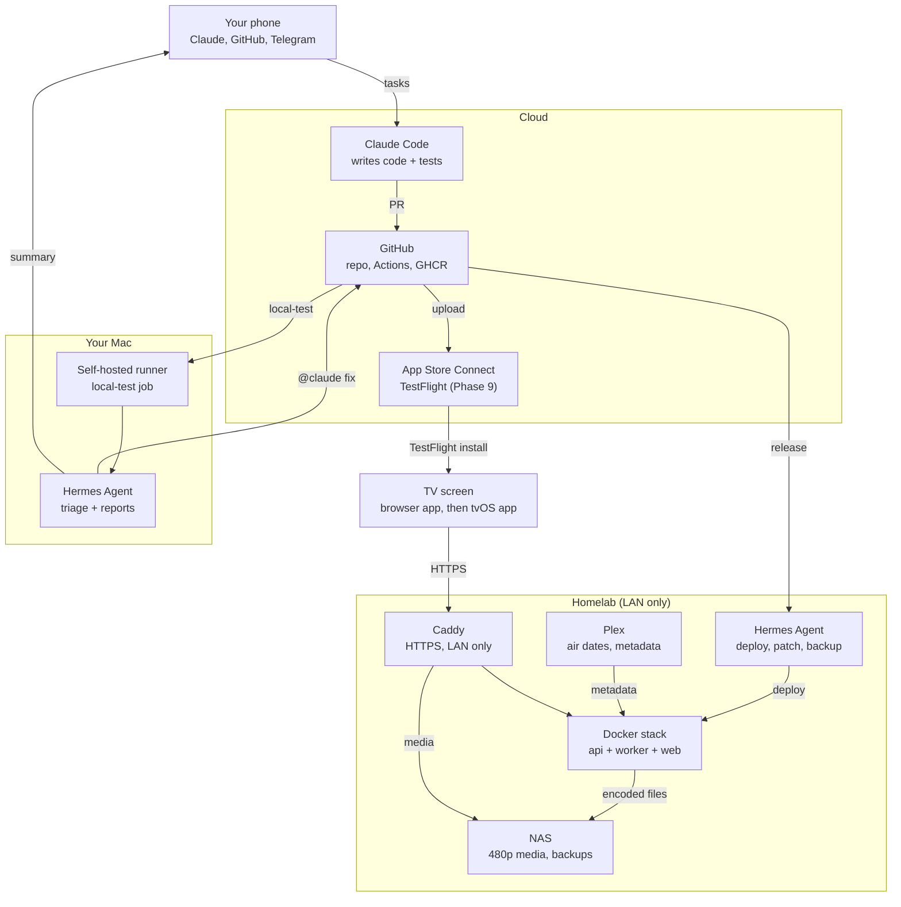

# Ops spec

Split from `docs/plan.md` (approved Nov 1, 2026) without changing its meaning; plan text is copied verbatim. Where this spec and the plan disagree, this spec wins for its area. Related specs: `scheduler.md`, `catalog.md`, `api.md`, `web.md`.

## Decisions locked

| Area | Decision |
| --- | --- |
| Build agents | Claude Code in the cloud writes all code; Hermes on the Mac runs local build and test; Hermes on the homelab deploys and patches |
| Apple signing | Paid Apple Developer account ($99/yr) and TestFlight, starting with the tvOS phase |

## How the work flows

Claude chat planned it, Claude Code builds it, Hermes tests and maintains it, and you approve from your phone.

1. You message Claude Code from your phone with a phase task (prompts are in `docs/phase-prompts.md`).
2. Claude Code reads `CLAUDE.md` and the specs, writes tests and code, and opens a PR.
3. GitHub Actions runs fast checks in the cloud; the self-hosted runner on your Mac runs the full local test and Hermes reports back.
4. A Claude review pass comments; you merge from your phone.
5. Merge to `main` publishes a container image (and from Phase 9, a TestFlight build).
6. Hermes on the homelab deploys with an allowlisted script, runs smoke tests and messages you.
7. You refresh the browser app; from Phase 9, TestFlight updates the Apple TV app too.

## Architecture

## Hosting, networking and security

Everything runs as one Docker Compose stack on an always-on homelab host, reachable only on your LAN at `tv.home.tabaska.us` through your existing Caddy.

| Service | Role | Exposure |
| --- | --- | --- |
| `api` | FastAPI: schedule, guide, tune, profile, telemetry intake, OpenAPI spec | Caddy → LAN only |
| `worker` | Plex import, ffmpeg normalize, holiday tagging, inventory report | None |
| `web` | Static browser app: TV screens plus `/admin` | LAN only; admin behind a password |
| `media` | Caddy `file_server` over the normalized media, read-only mount, byte ranges | LAN only, signed URLs |
| Observability | Prometheus, Loki, Grafana | LAN only |

SQLite holds the catalog and profiles; it is backed up nightly to the NAS.

### Network

- Split DNS: `tv.home.tabaska.us` resolves to the host's LAN IP inside the house and nothing outside.
- Caddy gets a real certificate via the DNS-01 challenge, so tvOS gets HTTPS without App Transport Security exceptions.
- The site block rejects any client outside private IP ranges; no port forward is ever added.
- Viewing away from home is out of scope for v1; Tailscale is the add-on path later.

### Access control

- Device pairing: the app shows a 6-digit code, you approve it in the admin (or Hermes asks you in chat), and the server issues a device token.
- Media URLs are HMAC-signed and expire in a few hours.
- App Store Connect keys live only in GitHub secrets. Homelab secrets live in a `.env` readable only by the deploy user.

### Hermes guardrails (homelab)

- Runs as its own Unix user with no shell sudo, only allowlisted scripts (`deploy.sh`, `rollback.sh`, `patch.sh`, `ingest.sh`, `backup.sh`).
- Its chat gateway answers only your account. Destructive actions (rollback, deleting media, reboots) need your reply first.
- It talks to your local model stack through LiteLLM.

## Git, CI/CD and releases

One private monorepo, `btabaska/retro-cable`; every merge to `main` produces a server image (and from Phase 9 a TestFlight build) without you touching a computer.

| Path | Contents |
| --- | --- |
| `CLAUDE.md` | Rules for agents |
| `docs/` | This plan, specs, phase prompts, status |
| `server/` | Python 3.12, FastAPI, SQLite, scheduler package, worker jobs |
| `web/` | TypeScript browser app and `/admin` |
| `tvos/` | SwiftUI app from Phase 9, generated by XcodeGen |
| `catalog/` | YAML: channels, eras, carriage, templates, overrides, holidays |
| `design/tokens.json` | Shared design tokens |
| `ops/` | Compose files, Caddy snippet, allowlisted scripts, Hermes skills |

### Workflow

- Trunk-based: short branches, one PR per task, conventional commits.
- Branch protection on `main`: CI green plus your approval. A Claude review pass comments first.
- Release Please turns merged commits into tags and a changelog.

### Pipelines (GitHub Actions)

1. **Server, every PR**: ruff, mypy, pytest with property tests, OpenAPI diff check against the generated web client.
2. **Web, every PR**: typecheck, Vitest, Playwright end-to-end in headless Chromium on fixture media.
3. **local-test, labeled PRs**: on your Mac's self-hosted runner (see below).
4. **On merge**: multi-arch server image to GHCR, tagged with the version.
5. **From Phase 9, on merge**: fastlane signs and uploads to TestFlight; a monthly rebuild keeps builds from expiring after 90 days. These run on the Mac runner to keep cloud macOS minutes near zero.

## Local build and test on your Mac

GitHub is the handoff point: Claude Code opens PRs, a self-hosted runner on your Mac tests them against a real local stack, and Hermes on the Mac reads the results and hands failures back to Claude Code.

| Piece | Runs on | Job |
| --- | --- | --- |
| Claude Code | Cloud | Writes code and tests, opens PRs, fixes failures |
| GitHub Actions | Cloud | Fast checks on every PR |
| Self-hosted runner | Your Mac | `local-test`: full stack in Docker, Playwright in WebKit and Chrome; tvOS builds from Phase 9 |
| Hermes Agent | Your Mac | Watches results, retries flaky tests, repairs its environment, writes failure reports, sends summaries |
| Hermes Agent | Homelab | Deploys, patching, ingest, backups |
| You | Phone | Read summaries, merge, ask for a TV check |

### The loop

1. Claude Code opens a PR labeled `local-test`; cloud CI runs fast checks.
2. The Mac runner checks out the PR, starts `ops/compose.test.yml`, runs Playwright, saves traces, screenshots and video, and posts pass or fail.
3. Hermes on the Mac acts on the result:
   - **Pass**: Telegram summary with screenshots and the PR link.
   - **Flaky**: retries once and files an issue to fix the test.
   - **Environment** (Docker stopped, disk full): fixes it from its runbook and reruns.
   - **Real bug**: posts a structured report on the PR and mentions `@claude`, which triggers the Claude Code GitHub Action to push a fix. After three rounds without a pass, it asks you.
4. You merge; the homelab Hermes deploys.

### Fixture media

- `make fixtures` generates fake shows with the show, episode and a running timecode burned into the picture, plus fake bumpers.
- Tests check the player's position against the offset `/tune` returned; screenshots show the timecode at a glance.
- No real video in the repo or CI; an opt-in suite on the Mac plays a few real NAS files read-only.

### Guardrails (Mac)

- The runner serves only this private repo, under its own macOS user. Never attach it to a public repo.
- Hermes on the Mac runs only allowlisted commands (`gh`, `docker compose`, `make test-*`, `npx playwright`, `xcodebuild`, runbook scripts). It can't merge, push to `main` or read release secrets.
- If the Mac sleeps, `local-test` jobs wait in GitHub's queue; cloud checks still gate every PR.

## Testing

| Layer | Tests | Runs |
| --- | --- | --- |
| Post-deploy smoke | `/health`, tune three channels, fetch one media range, check Grafana | Every deploy |
| On the couch | Your phase checklist: channel change feels instant, guide matches what plays | Phase sign-off |

## Maintenance with Hermes (homelab)

| Job | When | What it does | Asks you first? |
| --- | --- | --- | --- |
| Deploy | New GitHub release | Pull image, migrate DB, restart, smoke test, auto-rollback on failure | No (reports result) |
| Rollback | Smoke test fails or you ask | Restore previous image and DB snapshot | Yes, unless automatic |
| Ingest | Nightly 2 a.m. and on new Plex items | Import, normalize, tag, update inventory | No |
| Container patching | Weekly | Update base images; Renovate PRs cover app dependencies | No |
| OS patching | Weekly | Security updates; holds reboots for approval | Yes, for reboots |
| Backups | Nightly | SQLite and config to the NAS; monthly test restore | No |
| Cert and DNS check | Daily | Certificate validity and split DNS | No |
| Weekly report | Sunday | Telemetry summary, archive gaps, pending approvals, AI proposal | — |

When a job fails in a way its runbook doesn't cover, Hermes opens a GitHub issue with logs; Claude Code fixes the cause in the repo.

## Costs

| Item | Cost | Notes |
| --- | --- | --- |
| Apple Developer Program | $99/yr | Only from Phase 9 (tvOS) |
| Claude Code (cloud) | Your existing Claude plan | Heaviest during Phases 1–6 |
| GitHub Actions | Near $0 | Mac-only jobs run on your self-hosted runner |
| Disk | Only if the NAS lacks ~5 TB free | Prune the archive list first |
| Hermes, local models, Plex, Caddy, Grafana | $0 | Open source or already owned |
| TMDB API | $0 for personal use (confirm terms) | Metadata gaps only |

## Implemented (Phase 1)

### Where it runs

- **Stack:** the Ubuntu Mac mini (`mini`, 192.168.10.2), the homelab's Docker host. It has 4 cores, 7.6 GB RAM and about 2 GB free, which is plenty for api + web. The NAS has Docker but is the media store, the rig is the gaming/AI PC the plan rules out, and the mini already runs the homelab Caddy.
- **Media:** stored on the NAS (Synology, 192.168.10.4) and mounted on the mini over SMB, like the mini's other NAS shares. It is bind-mounted read-only into `web` at `/srv/media` (`RC_MEDIA_DIR`).
- **Checkout:** `/opt/retro-cable` on the mini, cloned with a read-only deploy key.
- **Reverse proxy:** the `caddy` container in `/opt/stacks/caddy`, on the external `edge` network. The live site block mirrors `ops/caddy/retro-cable.caddy`, and the Home repo (`foss-setup/configs/docker-stack/stacks/caddy/`) tracks it.
- **DNS:** the homelab wildcard already resolves `tv.home.tabaska.us` to the mini on the LAN.

### Images and compose

- Two images on GHCR: `ghcr.io/btabaska/retro-cable-api` (`server/Dockerfile`) and `ghcr.io/btabaska/retro-cable-web` (`web/Dockerfile`, Caddy serving the static build).
- `ops/compose.yml` runs `api` and `web`. `web` joins the external `edge` network under the alias `retro-cable-web`, so the homelab Caddy proxies to `retro-cable-web:80`. Its only published port is on loopback (`${RC_WEB_BIND:-127.0.0.1}:${RC_WEB_PORT:-8080}`), for `smoke.sh`. Inside the web container, Caddy serves the app, proxies `/api/*` to `api:8000` with the prefix stripped, and serves `/media/*` from `/srv/media`.
- `ops/caddy/retro-cable.caddy` imports the homelab's `local_tls` snippet (Let's Encrypt via Cloudflare DNS-01), drops any client outside `private_ranges`, and proxies to `retro-cable-web:80`. The homelab Caddy is in Docker, so `remote_ip` sees the client as Docker NAT sees it. The real LAN boundary is that no port is forwarded, and DNS answers only inside the house.
- `ops/compose.test.yml` overrides the stack to build both images from source, use a throwaway data volume, create a private `retro-cable-test-edge` network and mount `.fixtures/` read-only at `/srv/media`. `make stack-up` and `make stack-down` start and stop it.
- `ops/compose.build.yml` adds build contexts with the same image names, for `RC_IMAGE_SOURCE=build`.
- Host settings and secrets go in `ops/.env` (see `ops/.env.example`); compose reads it if present.

### Deploy scripts

All use `set -euo pipefail` and are covered by `ops/tests/`.

- `ops/deploy.sh <version>` accepts only `x.y.z` or `sha-<hex>`. With `RC_IMAGE_SOURCE=pull` (the default) it pulls that version from GHCR. With `RC_IMAGE_SOURCE=build` it builds from the checkout, and refuses unless HEAD is that commit or carries tag `v<version>`. Build mode is used on the mini until it has a read-only GHCR token, because the packages are private. It records the running version as previous, snapshots `retro-cable.db` from the data directory, pulls and starts the stack, and runs `smoke.sh`. On failure it calls `rollback.sh` and exits non-zero.
- `ops/rollback.sh` restores the previous version and its DB snapshot, then runs `smoke.sh`.
- `ops/smoke.sh` checks the web app, `/api/health` and `/api/version`. When an expected version is given, it checks the version for `x.y.z` and the commit for `sha-<hex>`, with retries. Tuning, media ranges and Grafana join in later phases.
- `deploy.sh` and `rollback.sh` read `RC_*` keys from `ops/.env` (or the file named by `RC_ENV_FILE`), and variables already in the environment win. `smoke.sh` defaults to `http://127.0.0.1:$RC_WEB_PORT`.
- State lives in `.deploy/` at the repo root (`current`, `previous`, `db-<version>.sqlite`); override with `RC_STATE_DIR`. The data directory defaults to `ops/data`; override with `RC_DATA_DIR`.

### CI/CD

- `server.yml` (every PR): ruff, mypy --strict, pytest for the server, the fixture generator and ops.
- `web.yml` (every PR): generated client drift check, tsc, eslint, Vitest, Playwright in Chromium.
- `local-test.yml`: runs on `[self-hosted, macOS, retro-cable]` only for same-repo PRs labeled `local-test`. It builds and starts the compose test stack, runs Playwright in Chromium and WebKit, and uploads the report, traces, screenshots and stack logs. One job at a time, because the stack binds port 8080.
- `release.yml` (push to `main`): Release Please maintains a release PR and bumps `server/src/retro_cable/__init__.py`. Every push builds multi-arch (amd64, arm64) images tagged `sha-<short>` and `edge`; a release also tags `<version>` and `latest`. Hermes deploys a version with `ops/deploy.sh`.

### Fixture media

- `make fixtures` runs `tools/fixtures/generate.py`: 3 shows × 3 episodes of 60 s and 2 bumpers of 5 s, 640×480 H.264 + AAC with faststart and a keyframe every second, in Plex naming under `.fixtures/` (bumpers under `.fixtures/_bumpers/<channel>/fixture/`), plus `manifest.json`.
- Each frame shows the show, the episode and a timecode to the tenth of a second. Frames are drawn with Pillow and piped to ffmpeg, so ffmpeg needs no drawtext/freetype support (Homebrew's build lacks it). Reruns skip clips that already exist.
